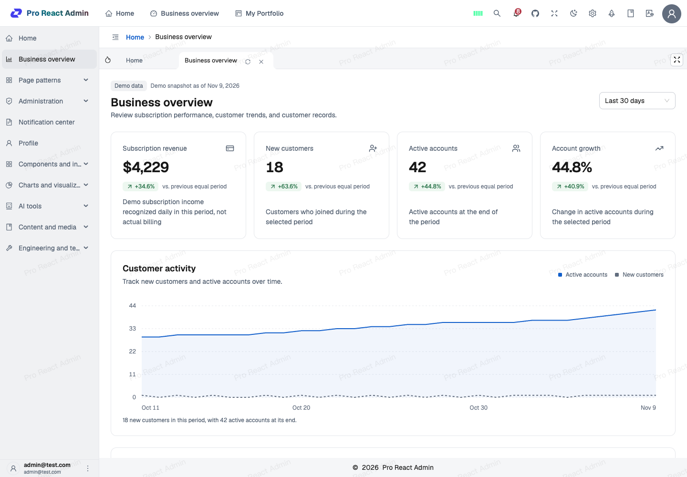
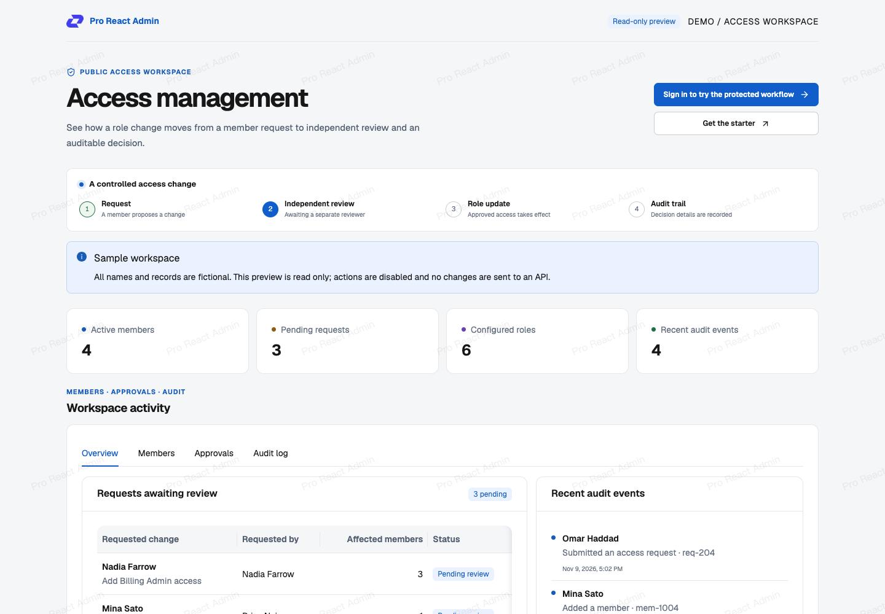
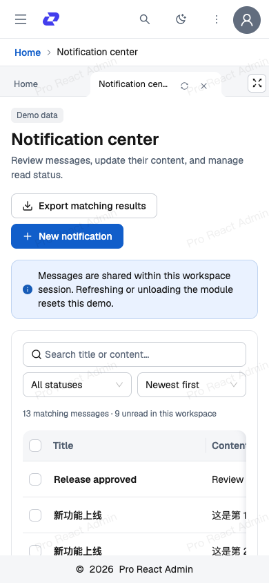

# Pro React Admin

[简体中文](./README.md) · [English](./README.en.md)

A React admin scaffold for teams, with tenant permissions, audit logs, and reusable business page patterns.

**[Try the public preview — no sign-in required →](https://pro-react-admin.vercel.app/#/preview/access)**

- **Start with working tenant access control.** The Enterprise preset includes tenant sign-in, server authorization, persistent users and roles, and transactional audit logs.
- **Build from business page examples.** Query tables, basic and stepped forms, detail pages, and submission results come with source, data Provider, and permission guides.
- **Choose the engineering tools you need.** The same source supports Webpack and Vite, with optional multi-project and microfrontend examples and a separate UI package.

[Source](https://github.com/wkylin/pro-react-admin) · [Engineering guide](./docs/architecture/ENGINEERING_OVERVIEW.md) · [Full demo](https://pro-react-admin.vercel.app) · [Storybook](https://wkylin.github.io/pro-react-admin/storybook/)



Screenshots and the [45-second demo video](./docs/media/demo-walkthrough.webm) ([MP4](./docs/media/demo-walkthrough.mp4)) show a local demo. The public preview uses fictional data and is read-only.

<details>
<summary>Access management and mobile notifications</summary>

| Public access preview                                                               | Mobile notifications                                                                           |
| ----------------------------------------------------------------------------------- | ---------------------------------------------------------------------------------------------- |
|  |  |

</details>

Built with React 19, Ant Design 6, React Router 7, Zustand 5, and TypeScript 6.

## Start your project

Use **Node.js >=24.15.0 and <25** and **pnpm 12.16.1**, as specified in the root `package.json`.

```bash
# If pnpm is not installed: npm install --global pnpm@12.16.1
git clone https://github.com/wkylin/pro-react-admin.git
cd pro-react-admin
pnpm install --frozen-lockfile
pnpm run project:create myApp --preset enterprise
PROJECT=myApp pnpm start
```

Run these commands from the repository root. On Windows, replace the last command with `pnpm exec cross-env PROJECT=myApp pnpm start`.

The Enterprise preset creates an independent project within the workspace. It defaults to Vite and starts both the frontend and the local Enterprise API. First startup creates an isolated SQLite demo tenant. Open the address printed in the terminal and use the local demo account shown on the sign-in page.

To inspect the generated files before creating a project, use `pnpm run project:create myApp --preset enterprise --dry-run`. See the [project scaffold guide](./docs/development/MULTI_PROJECT.md) for module registration, build commands, and production configuration.

## Explore the demo

- [Public access preview](https://pro-react-admin.vercel.app/#/preview/access): browse fictional members, approvals, and audit records without signing in or changing data.
- [Full showcase](https://pro-react-admin.vercel.app): sign in to explore the dashboard, notifications, and business page patterns.
- [All GitHub Pages applications](https://wkylin.github.io/pro-react-admin/portal.html): showcase, Enterprise demo, multi-project examples, microfrontends, and Storybook. New changes appear after a successful deployment.

To run the showcase locally, use `pnpm start`. Open the printed `/#/signin` address, select `admin@test.com` to fill the password generated for your browser, then sign in and complete the slider interaction. There is no shared fixed password. The command starts the frontend and a local API; development tracking uses memory and does not require MongoDB.

The showcase uses browser demo providers. Dashboard figures are demo data. Business page pattern records live only in the current browser workspace session, including when those patterns are opened from Enterprise.

The Enterprise preset instead uses `server/enterprise/` for tenant sign-in, server authorization, persistent resources, and audit records. Its local SQLite demo tenant persists across restarts. A production deployment needs its own API, database, and configuration; follow the [Enterprise guide](./docs/operations/ENTERPRISE.md).

## Webpack or Vite

The showcase and existing examples default to Webpack. New Enterprise projects default to Vite. Both use the same application and component source.

| Task                   | Webpack                  | Vite                      |
| ---------------------- | ------------------------ | ------------------------- |
| Frontend and local API | `pnpm run dev:webpack`   | `pnpm run dev:vite`       |
| Build the default app  | `pnpm run build:webpack` | `pnpm run build:vite`     |
| Default app output     | `dist`                   | `dist-vite`               |
| Storybook development  | `pnpm run storybook`     | `pnpm run storybook:vite` |
| Build the UI package   | `pnpm run build:lib`     | `pnpm run build:lib:vite` |

For a generated Enterprise project, use `pnpm run project:build myApp`. To select Webpack explicitly, use `pnpm run project:build myApp --bundler=webpack` or `pnpm exec cross-env BUILD_TOOL=webpack PROJECT=myApp pnpm start`.

Project commands also accept `--bundler=vite`; this overrides `BUILD_TOOL`. Stop the current development server before switching. Both UI package builds write to `packages/wui-react/dist`, so run them sequentially. See the [build guide](./docs/development/BUILD.md) for output paths, environment variables, and bundle reports.

## Use the components separately

The admin application is private in `package.json`. The UI package, [`@w.ui/wui-react`](./NPM_README.md), has its own build and release process. It provides base components and grouped layout, forms, data display, animation, media, visualization, and editor entry points.

Browse the [interactive Storybook](https://wkylin.github.io/pro-react-admin/storybook/) or run `pnpm run storybook` locally. The [package usage guide](./NPM_README.md) lists installation commands, peer dependencies, imports, and integration requirements.

## Guides and contribution

Most detailed engineering and deployment guides are currently in Chinese.

- [Getting started: commands, accounts, and local previews](./docs/development/GETTING_STARTED.md)
- [Business page patterns: UI, source, Providers, and permissions](./docs/development/PAGE_PATTERNS.md)
- [CRM demo: customers, follow-ups, and opportunity stages](./docs/development/CRM_DEMO.md), with session-only fictional data
- [Architecture and module boundaries](./docs/architecture/ARCHITECTURE.md)
- [Tenant permissions and Enterprise resources](./docs/operations/ENTERPRISE.md)
- [Multi-project scaffolding](./docs/development/MULTI_PROJECT.md) and [microfrontends](./docs/deployment/MFE_DEPLOYMENT.md)
- [GitHub Pages and Vercel deployment](./docs/deployment/PAGES_VERCEL_GUIDE.md)
- [Quality checks](./docs/development/QUALITY.md), [contribution guide](./CONTRIBUTING.md), and [security policy](./SECURITY.md)
- [Full documentation index](./docs/README.md)

Licensed under the [MIT License](./LICENSE).
