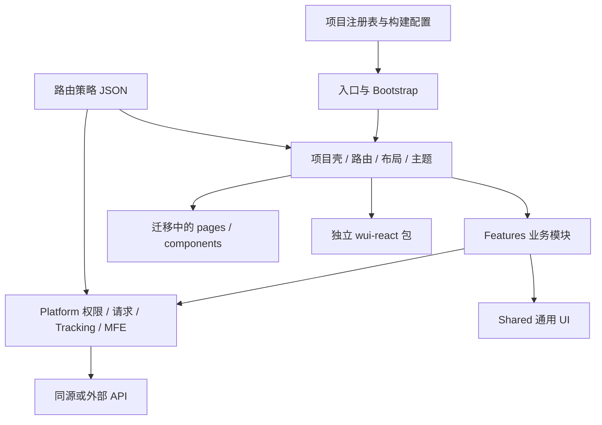

# 技术架构

## 定位与工作区

这是一个浏览器 React 管理界面、多个项目样例、Module Federation 示例和独立 UI 包组成的 pnpm workspace。根应用不是 SSR 项目；api/ 是 Express OAuth 与埋点 helper，不是完整业务后端。

React 19、React Router 7 Hash Router、Ant Design 6 与 Zustand 5 负责运行时；Webpack 5、Babel 8、esbuild 与 TypeScript 6 负责构建及检查。声明版本由[实现参考](PROJECT_REFERENCE.md)生成，安装版本由 lockfile 决定。

## 当前边界

| 层                           | 职责与依赖                                              |
| ---------------------------- | ------------------------------------------------------- |
| bootstrap                    | React root、StrictMode、AntdApp、i18n、错误边界、Sentry |
| projects / layouts / routers | 项目装配、导航、Tabs、页面容器、入口选择                |
| features                     | 按业务组织 pages、hooks、api、model，使用公开 index.ts  |
| platform                     | 浏览器基础设施；不能导入业务页面或布局                  |
| shared                       | 通用组件、纯工具；不能反向依赖 platform 或业务          |
| packages/wui-react           | 自包含可发布 UI；不能导入应用 src                       |
| pages / components           | 尚未完全迁移的页面、演示和历史组件                      |

scripts/check-import-boundaries.mjs 强制 shared、platform 和 UI 包的导入方向；它检查静态 import/export 与字面量动态 import，不是完整模块依赖分析。别名由 config/path-aliases.json 派生并检查。

## 路由与授权

路由模块保留页面结构，config/route-policy.json 统一权限、标题和 i18n key，菜单配置负责图标与排列。注入过程继承最近的父级策略，契约检查识别重复路径、缺失菜单页面及失效策略。mock 权限也使用同一策略，不是策略来源。

PermissionService 以身份键隔离缓存，正常缓存有效期为 30 分钟。刷新失败清除授权，在途响应在切号、清缓存后失效。路由守卫按实际匹配的叶子路由判定权限与角色，避免父路由覆盖子页面；拒绝访问进入 403。有效身份缓存可同步判定切页访问，保留布局与 Tab 表单状态。菜单过滤和按钮守卫共享授权服务。前端控制可见性和交互；业务服务仍必须独立授权。

## 请求与领域数据

Axios request.js 与 Fetch http.js 保留各自传输能力，复用严格类型的 core/async、core/response、core/encryption 及 session 处理。HTTP/business 错误统一，成功 envelope 保留；领域 API 显式 unwrap 并验证 unknown。类型化 apiClient/fetchClient 提供新代码入口，泛型声明不代替运行时校验。

features/business 展示该模式：两个公司资质请求并行、结构解码、卸载取消。它仍使用外部示例数据源，实际部署要解决认证、CORS 与业务服务契约。

## 状态与性能

Zustand 全局 store 只维护侧栏和断点，持久化侧栏状态。业务状态保留在 feature hooks 或页面内部，权限缓存单独管理。首页与作品集进入懒加载配置；图表、媒体、编辑器等重型页面按路由加载。初始 JS/CSS 预算来自 config/bundle-budget.json，体积参考必须由 stats 重新测量。

UI 包直接从 packages/wui-react/src 构建 ESM/CJS、统一 CSS 与声明文件，旧 src/lib 聚合入口已移除。Tracking SDK 属于 platform；它不随 UI 包发布。

## 剩余演进

根 tsconfig.strict 仍为 false，平台新核心、业务边界和 UI 包开启严格检查；遗留请求适配器仍为 JavaScript。pages/components 的迁移按业务发生时逐步完成，避免仅改目录名称。

后续重点是缩小初始共享依赖、迁移旧 JS 的类型边界、拆分演示依赖，以及完善真实服务契约。Tracking Provider 的实例创建仍在渲染期，动态插件与 StrictMode 生命周期需要专项改造；Image GET 兜底也不匹配本地仅 POST collector，详见[Tracking](TRACKING_SDK_ARCHITECTURE.md)。
