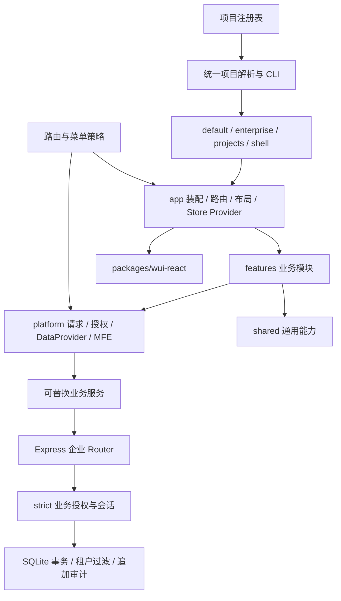

# 技术架构

## 产品与应用边界

Pro React Admin 是 React 管理应用工作区，包含组件展示应用、精简企业入口、多个独立项目、Module Federation Host/Remote 和独立 UI 包。它采用 React 19、Ant Design 6、React Router 7 Hash Router、Zustand 5、Webpack 5、TypeScript 6。声明版本见[自动生成参考](PROJECT_REFERENCE.md)，安装版本以 lockfile 为准。

`default` 保留展示功能；`enterprise` 仅注册工作台、用户、角色、审计、认证和错误页。两者复用应用壳，但具有独立入口、路由、状态命名空间与产物。`api/enterprise` 提供可选的真实业务后端：租户账号、RBAC、持久化用户/角色、会话撤销与事务审计。它适合单实例自托管；前端仍可通过 Provider 接入其它业务服务。

## 代码组织

| 目录                   | 职责                                                     | 约束                                      |
| ---------------------- | -------------------------------------------------------- | ----------------------------------------- |
| src/app/bootstrap      | React root、统一 Application、RemoteScope、Provider 装配 | 入口返回 root/store/unmount，支持明确销毁 |
| src/app/routing        | 展示应用路由模块、认证装配                               | 通用路由算法在 platform/navigation        |
| src/app/layouts        | 导航、搜索、面包屑、Tabs、布局预设                       | 使用项目路由和共享权限快照                |
| src/app/model          | 应用壳 Store 工厂与 Provider                             | 每个根实例独立，持久化按 projectId 命名   |
| src/features           | 按领域组织 pages/api/model/hooks                         | 页面通过领域 API 或 DataProvider 访问数据 |
| src/platform           | 请求、授权、导航、缓存、MFE、PWA、Tracking               | 不导入 app、features、pages、projects     |
| src/shared             | 通用组件和纯工具                                         | 不反向依赖平台或业务                      |
| src/projects           | 项目入口与路由差异                                       | 复用装配与平台，不复制基础算法            |
| packages/wui-react     | 可发布 UI 组件                                           | 自包含，禁止导入应用 src                  |
| api/enterprise         | HTTP adapter、业务服务、SQLite 存储、显式租户初始化      | 业务核心 strict；授权和审计在服务端执行   |
| src/pages / components | 展示页面和待迁移组件                                     | 新业务优先进入 features；按业务变化迁移   |

`config/path-aliases.json` 派生 TS/Jest/Webpack 别名。`@routers` 是构建时项目路由别名；`@app/routing` 明确指共享装配与展示路由，不等于当前项目。导入方向由 `check:import-boundaries` 强制检查。

## 路由、菜单与授权

`config/route-policy.json` 是权限、标题、翻译、菜单父级、排序和图标名的维护入口。页面结构仍由路由模块表达。导航树统一供侧栏和全局搜索使用，并同时过滤未注册页面和未授权页面；空分组不展示。面包屑从 React Router 实际匹配生成，参数页使用实际地址。`normalizeRouteTree` 统一 index/相对路径/绝对路径和 Tab metadata，projectB 不再复制算法。

`PermissionService` 维护身份绑定的缓存和订阅快照，`useSyncExternalStore` 让路由、菜单、按钮和角色守卫同时响应刷新、失败撤权、同页退出和跨标签页身份变更。订阅期间缓存到期会重新同步，回到窗口也检查失效缓存。旧请求由 generation 与当前凭据双重检查丢弃。策略优先于宽泛 routes grant，未知路径须显式授权。详见[授权](USER_ROLE_PERMISSION.md)。

## 状态与生命周期

`createAppStore`/`AppStoreProvider` 为每个应用根创建 Zustand store，只持久化侧栏偏好，键为 `pro-react-admin:<projectId>:shell`；主题使用独立 `:theme` 键。业务数据、登录身份、ReactNode 和断点不持久化到壳 Store。同一个 projectId 的不同根仍隔离内存；后续根可以恢复同项目偏好。

`KeepAliveProvider` 管理本根的缓存、LRU 和定时器，默认保留最多 5 个非持久页面，首页独立保留。退出 Provider 取消定时器；Remote 的相同 pathname 不会互相驱逐。Tabs 刷新使用 generation 实际重挂载当前页面，保留其它页草稿。缓存限额以内保留草稿，超过限额会丢弃最旧页；这不是永久草稿存储。

`SessionScope` 在凭据或租户变化时销毁页面树、Tabs、KeepAlive 与业务 Provider，避免旧身份的数据与表单进入新工作区。企业权限缓存绑定 tenant/token，资源缓存实例绑定当前会话。当前 origin 仍只有一个活动身份，跨标签页共享并同步切换；不支持多个并行身份。Module Federation 不提供权限或样式沙箱，不可信子应用须使用独立 origin/iframe。

## 数据与功能

`platform/modules` 提供编译期模块契约 v1：模块声明 routes、resources、Provider、dependencies 和 Header 插槽。default 选择组织管理与通知，enterprise 仅选择组织管理。注册表检查版本、依赖环、重复路由和精确权限策略，Provider 随应用根创建与销毁；通知 Store 已消除全局单例。公共 Header 通过模块插槽装配通知，详见[模块指南](MODULES.md)。

`platform/data/provider.ts` 定义分页、查询、取消、CRUD 和资源解析契约；REST adapter 复用已有请求层和会话处理，响应经领域 parser 验证。`features/administration` 提供用户 CRUD、角色配置、状态编辑、查询/分页和只读审计。demo Provider 在应用实例中维护数据并检查角色引用，REST Provider 对接真实接口；详见[企业资源接入](ENTERPRISE.md)。

`platform/data/cache.ts` 在 Provider 上装饰服务端数据缓存：按会话创建实例，资源/记录/规范查询组成键，15 秒 TTL、最多 100 项、同键请求共享、每消费者独立取消。成功写入通知相关资源重新加载，用户/角色写入失效审计，角色写入同时失效用户和角色选项；失败不缓存。失效或身份变化后，在途旧结果不能重新填充缓存。它是浏览器内存缓存，尚无后台刷新、乐观更新、实时订阅或分布式缓存。其它 feature 暂未统一迁移。

企业后端使用 Node 24 原生 TypeScript 与 SQLite，不新增数据库驱动。HTTP、业务授权、存储分别组织；所有列表/记录/写入按服务端会话的 tenant_id 过滤，header 不能选择另一个租户。每次请求从数据库读取有效账号和角色，不缓存授权结论。业务写入、会话撤销、审计在同一事务提交；数据库触发器拒绝审计 UPDATE/DELETE。数据库管理员仍可修改文件或触发器，因此它不是外部防篡改审计系统。边界与部署要求见[企业资源](ENTERPRISE.md)。

## 构建、部署与性能

`config/project-registry.mjs` 为 Webpack、项目命令、预览、清理、脚手架和部署组合提供同一项目解析；拒绝越界和重叠产物目录。脚手架同步 Remote import/type、部署 headers 和项目参考。生产缓存按项目/MFE 角色/环境隔离。

Sentry 在启用时动态加载；设置抽屉、鼠标效果、轨迹按需加载，装饰动画默认关闭。企业路由树不引用展示路由清单，避免把图表/媒体/编辑器编译为业务页面。实际收益由 stats 和浏览器检查确认，见[验证记录](VALIDATION.md)。

部署使用现成产物组合，支持 Vercel、GitHub Pages 和 Nginx 静态镜像；HTML/Remote entry/manifest 及时刷新，内容 hash 资源长期缓存。CI 分别验证展示、企业、微前端、Storybook、组件库，上传可复用产物。修改流水线不代表已部署。

## 下一阶段

对标依据、已处理劣势和优先级见[开源对标](BENCHMARKS.md)。下一阶段优先推进 OIDC/SSO、多组织成员关系、租户运营与数据库升级/备份治理；随后扩展查询缓存的后台刷新与实时失效、运行期插件和兼容性治理、遗留 JS 类型化及全仓 strict。根 strict 尚未打开；新增业务后端通过独立 strict 门禁。SSR/路由 loader、Tracking 生命周期和 Web Vitals 仍需按实际业务评估。
