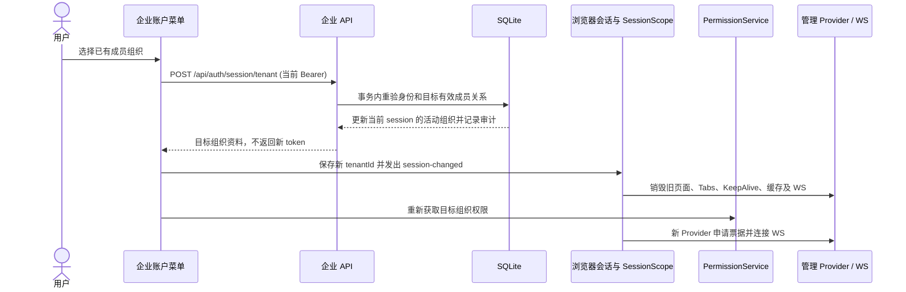
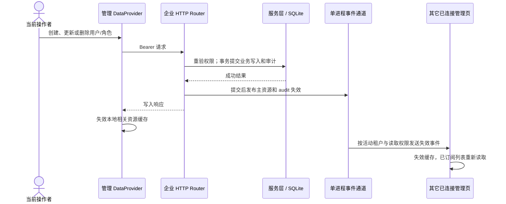

# 运行时链路与信任边界

本文描述当前仓库的运行行为。静态目录与依赖方向见[技术架构](ARCHITECTURE.md)，接口字段见[企业资源](ENTERPRISE.md)与[API](API.md)，单实例部署示例见[Vercel 与 SQLite](VERCEL_SQLITE.md#选择部署方式)。这些链路不表示生产环境已完成上线验收。

## 身份切换与撤权

目标成员关系不存在时 API 返回 403，旧组织页面保持当前会话。客户端会在切换请求返回后核对发起时的身份，避免旧请求覆盖另一标签页或同页新身份。会话标识包含 tenant 与 token；同一 origin 只有一个活动浏览器身份。服务端每次业务请求重新读取会话、成员状态和角色，`X-Tenant-ID` 不能改变授权租户。角色权限变化不会推送新的 UI 权限快照；已挂载界面通过权限缓存到期、窗口聚焦或下一次请求同步，服务端授权立即按当前数据库状态判断。来源：[账户切换](../src/app/layouts/proHeader/index.tsx)、[会话](../src/platform/auth/model/session.ts)、[权限](USER_ROLE_PERMISSION.md)。

## 写入与资源失效

写事务失败不会发布失效。WS 连接先用现有 Bearer 向 `/api/events/ticket` 申请 30 秒一次性票据，再经 `pro-admin-events-v1` 子协议认证；URL 与子协议不携带 bearer。服务端不发送记录值、用户 ID 或租户 ID。客户端断线后退避重连并带上游标；首次连接、进程重启或回放窗口丢失时收到 `reset`，清理当前身份下全部资源缓存。事件日志只在单个 API 进程内，不能跨实例同步。

WS 断开期间，已渲染的列表可能继续显示旧值。缓存 15 秒 TTL 仅在下一次读取时生效，不会自行触发页面刷新；手动刷新、后续读取或重连后的失效通知才会更新可见内容。资源失效与角色权限快照是两条不同链路。来源：[缓存实现](../src/platform/data/cache.ts)、[事件客户端](../src/platform/data/resourceEvents.ts)、[HTTP 发布](../api/enterprise/router.cjs)、[事件服务](../api/enterprise/events.cjs)。

## Remote 加载与兼容

Shell 先请求 Remote 同目录的 `remote-manifest.json`，校验 schema、名称、协议和共享依赖，再加载 `remoteEntry.js`。加载最多尝试两次；失败展示不可用状态，整页刷新会重新建立 Federation 运行时并重新检查 manifest。Bridge 的 `mfe:*` 消息只在 Host/Remote 浏览器上下文传递，企业资源 WS 是独立服务端协议。完整构建与缓存规则见[微前端部署](MFE_DEPLOYMENT.md)。

| 契约              | 当前支持                                                | 不兼容时的行为                                               |
| ----------------- | ------------------------------------------------------- | ------------------------------------------------------------ |
| 静态业务模块      | manifest v2，宿主版本范围和能力声明在装配前校验         | v1、未知版本、依赖/路由/权限冲突直接拒绝装配；无运行期协商   |
| Federation Remote | Host 校验当前 manifest、协议和 sharedDependencies       | 拒绝注入不兼容 entry，页面展示 Remote fallback               |
| 企业数据库        | API 只接受已验证的当前 schema；已知旧 schema 走离线迁移 | 待迁移或未知 schema 拒绝启动；旧 artifact 回滚须恢复兼容快照 |
| 资源事件          | 单实例 `pro-admin-events-v1` 与有限重放                 | 游标不可续接时 `reset` 全量失效；多实例一致性未实现          |

模块 v2 的迁移字段只声明数据版本、checksum、备份及回滚要求，不在浏览器执行迁移。数据库升级与旧 artifact 回滚必须遵守[恢复 runbook](runbooks/ENTERPRISE_RECOVERY.md)。

## 信任与故障边界

| 边界            | 当前约束                                                                                                     | 失败或运营动作                                                         |
| --------------- | ------------------------------------------------------------------------------------------------------------ | ---------------------------------------------------------------------- |
| 浏览器到 API    | 浏览器 localStorage 保存一个 bearer；服务端以会话表、活动租户和当前角色授权；生产须 HTTPS 与精确 CORS origin | 401 清当前请求身份，403 保留会话；不能以隐藏按钮代替服务端权限         |
| 浏览器到事件 WS | HTTP 票据绑定 session/principal/tenant，WS 事件仍按当前读取权限过滤                                          | 4401 清理失效会话；其它断线退避重连，期间页面可能显示旧值              |
| Host 到 Remote  | Remote JavaScript 在 Host 页面上下文运行；manifest 校验的是兼容性                                            | 不可信代码需独立 origin 的 iframe；跨域脚本地址本身不提供沙箱          |
| API 到 SQLite   | 单 API 实例和持久卷；业务写入、相关会话撤销和审计在事务内                                                    | schema 异常拒绝启动；按恢复 runbook 校验备份、恢复与旧版本回滚         |
| 构建到部署      | API/Remote 浏览器地址属于构建配置，服务端管理 token 与数据库路径留在服务器                                   | 环境切换需要重新构建或经验证的运行时配置方案；不得把密钥注入浏览器产物 |

Sentry、Web Vitals 和当前监控盲区见[可观测性](OBSERVABILITY.md)。真实部署 RPO/RTO、跨实例事件发布和第三方插件隔离仍是未完成的架构门禁。
