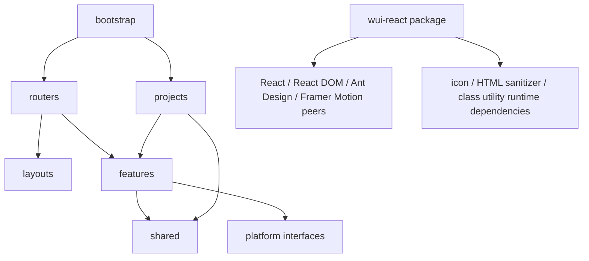

# 工程架构评估与演进方案

本文从模块边界、组件资产、构建发布、样式、布局扩展和质量治理评估当前仓库。数量来自[自动生成的组件清单](./COMPONENT_CATALOG.md)，可通过 `pnpm run generate:component-catalog` 更新。

## 结论

项目已经具备不少企业应用需要的工程能力：Webpack 构建入口统一，多项目与 Module Federation 有注册表和契约，组件库有独立 npm package，Vercel/GitHub Pages 有各自部署配置，CI 覆盖配置检查、类型检查、Jest、Playwright、Storybook、组件库和微前端构建。

目前的主要风险是**功能规模增长快于代码边界的演进**。项目、页面、共享 UI、状态服务和发布 API 同时存在，但目录仍以 `stateless/stateful` 和页面大目录为主；组件越来越多，模块归属、公开 API、主题样式和验证要求没有形成同一套可持续约定。因此，当前需要做的是逐步建立清晰边界，而不是把数百个文件一次性搬家。

## 当前结构与指标

| 领域          | 现状                                                                                                                          | 工程影响                                                                   |
| ------------- | ----------------------------------------------------------------------------------------------------------------------------- | -------------------------------------------------------------------------- |
| 源码规模      | 当前规模见自动生成的源码清单                                                                                                  | 完整分类与统计口径见[组件与源码清单](./COMPONENT_CATALOG.md)               |
| 共享 UI       | `src/shared/ui` 保存应用级复用模块；`packages/wui-react/src` 有 12 个公共组件目录；历史 `stateless/stateful` 仍待按所有权迁移 | package 与应用共享层已有明确准入边界；旧目录不再新增组件                   |
| Hooks         | `src/components/hooks` 有 49 个历史 Hook 模块；布局 Hook 在 `layouts`，平台导航和认证 Hook 在 `platform`                      | 按调用者迁入 `shared/hooks`、feature 或 platform；旧目录不再新增 Hook      |
| 页面与项目    | `src/pages` 有 57 个入口模块，分布在 39 个直接子目录；`src/projects` 有 6 个入口模块                                          | 页面按演示名称组织，跨项目共用逻辑和项目私有逻辑边界需要持续校验           |
| Feature-first | `tracking`、`notifications` 与 `dependencies` 已按领域组织页面、组件、hooks、store/数据与模型；路由加载 feature 入口          | feature 已纳入 strict 类型检查；业务埋点不再作为组件库兼容入口发布         |
| 路由与权限    | `src/routers/routeRegistry.ts` 按功能分组；元数据含功能类别、访问级别与布局类型                                               | 根守卫已复用共享实现；菜单元数据与权限 mock 尚未合并，需要后续建立校验     |
| 状态管理      | 全局 `useAppStore` 只管理应用壳；通知 store 属于 feature；示例 store 属于页面；临时交互留在 React state                       | 全局/领域/局部生命周期已区分；历史 store/service 仍需按所有权迁移          |
| 布局扩展      | `src/layouts` 提供 `side/top/mix` preset registry、类型化覆盖和 header/sider/content slots                                    | 默认组合保留现有行为；项目可通过 `createLayoutRegistry` 扩展槽位和导航位置 |
| 组件 API      | v5 的 12 个组件、类型、样式与子路径全部由 `packages/wui-react` 持有；应用级大 barrel 已删除                                   | npm 构建不读取 `src`；公共 API 由 export map 和语义化版本管理              |
| 样式          | 样式与 CSS Modules 数量以自动生成清单为准                                                                                     | 模块样式基础不错；剩余全局样式、组件内联值和主题 token 需要约束            |
| 文档与演示    | Storybook、源码测试数量以自动生成清单为准                                                                                     | 公开组件的交互、暗黑主题、响应式和无障碍状态覆盖不足                       |
| 工具配置      | 根 package 有大量应用、项目、组件库和发布脚本；workspace 包含根应用、API、`packages/wui-react`                                | 有多个命令别名和专项发布命令，新人不容易分辨标准命令                       |
| 部署目标      | 5 个 Vercel JSON 配置和 GitHub Pages workflow                                                                                 | 部署目标多；仓库配置与平台控制面板必须继续保持一致                         |
| 类型边界      | 全量类型检查覆盖应用；strict 检查覆盖路由工具、KeepAlive、MFE bridge、`src/features`、`src/shared` 和 `src/platform`          | 新迁移层由 CI 执行 strict 检查；旧目录仍分阶段迁移                         |

清单里的组件数字按入口目录/文件统计，不是对所有 React 函数组件做 AST 识别后的总数。它反映当前目录维护面，并保留每个模块名称，适合追踪分类和迁移变化。

## 组件分类与归属规则

现有清单主要描述历史目录分布；新代码按职责和所有权归类，避免继续按“有没有内部 state”分类：

| 类别           | 放置位置                           | 判断标准                                                |
| -------------- | ---------------------------------- | ------------------------------------------------------- |
| 领域组件       | `src/features/<domain>/components` | 仅服务一个业务域，含该域术语、接口或状态                |
| 应用共享 UI    | `src/shared/ui`                    | 多个 feature 可复用；不依赖具体业务路由、页面或 feature |
| 公共组件库     | `packages/wui-react/src`           | API 稳定、无应用私有依赖，适合独立发布给其他项目        |
| 布局与平台能力 | `src/layouts`、`src/platform`      | 承担应用框架、权限、认证、遥测、微前端等横切能力        |
| 演示页面       | `src/pages`                        | 单一展示或技术示例；升级为产品业务后迁入对应 feature    |

组件入哪个分类由复用范围和运行时依赖决定，不由组件内部是否使用 React state 决定。应用内部不保留废弃路径的兼容导出；可发布包的 API 变更必须按语义化版本显式管理。

### `packages` 的工程作用

根级 `packages/` 是 monorepo 中可独立构建、测试、定版和发布的 package 集合。目前的 `packages/wui-react` 面向外部 React 项目，不承担本应用的业务编排。它拥有自己的 `package.json`、版本、export map、peer dependencies 和发布生命周期；根应用只是该 package 的一个使用方。

Git 保存 package manifest、`src/**`、Story、测试和发布 workflow。`node_modules`、`dist` 及准备发布时复制的 package README/LICENSE 都是可重建产物，不提交。CI 从干净 checkout 重新构建并检查 tarball，才能证明发布不依赖开发者本机残留文件。

当前公共目录为 `AnimatedIcon`、`IconFrame`、`MoveChecker`、`OneTimePasscode`、`OverflowText`、`PortalTooltip`、`ResponsiveTable`、`SafeHtml`、`ScrollLayout`、`ScrollableSections`、`SliderCaptcha` 和 `WatermarkProvider`。主入口导出全部组件，每个组件另有 kebab-case 子路径；未列入 `package.json#exports` 的文件均为内部实现。

## 当前结构的主要不足

### 1. 组件按实现方式分类，不按职责和所有权分类

`src/components/stateless` 是最大集合，当前有 155 个入口模块，其中 139 个在该目录第一层，16 个是嵌套入口。目录中有不少有内部状态、请求、导航或业务语义的组件，因此“stateless”会误导使用者。`stateful` 只有 4 个模块，也无法表达组件的领域归属。新共享 UI 从该目录迁出后集中放入 `src/shared/ui`，布局包装器迁入 `src/layouts`。

将组件继续堆进这两个目录，会使搜索、代码所有权和 bundle 依赖越来越难判断。新增模块应按“应用功能”“共享 UI”“平台能力”归属；历史模块按功能批次迁移，不再向旧目录增加新组件。

### 2. 页面、业务逻辑和组件资产没有形成 feature vertical slice

历史页面主要在 `src/pages`，项目差异在 `src/projects`，部分旧组件仍在 `src/components/stateless` 和 `stateful`。新增或修改一个业务域时，开发者需要跨多个目录找页面、请求、状态、组件和样式。新业务应在 `src/features/<domain>` 内按垂直切片组织。

### 3. 组件库边界已独立，发布治理需要持续执行

v5 将 12 个公共组件收敛到 `packages/wui-react/src`，主入口、按组件子路径、类型和样式都由 package 自己持有。`/core`、`/stateful`、`/stateless` 和 `/tracking` 兼容入口不再发布，npm 构建也不再读取 `src/lib`。import boundary 检查必须持续阻止 package 反向导入应用 `src`、路由、store、service、环境配置和项目 alias。

接下来的风险来自 API 治理：每个新增 export 都会成为外部契约，需要同时具备稳定 Props、主题与 SSR 约束、依赖归属、Story/测试、bundle 评估和语义化版本说明。源码放进 `packages` 并不自动代表它适合发布。

### 4. 组件校验不足以支撑大型团队协作

Storybook 静态构建已经进入 CI，但 Story 不等于完整行为测试。12 个公共组件需要统一的属性/API 示例、空/加载/错误状态、暗色主题、键盘可达、SSR 导入和窄屏状态。Storybook 已加入 a11y addon；发布门禁还应持续补齐关键交互测试和按组件 bundle 检查。

### 5. 样式虽以 CSS Modules 为主，主题契约还不够显式

87/93 样式文件使用 CSS Modules，局部样式冲突风险较低；但全局覆盖和硬编码颜色、边框、间距仍会导致暗色主题和品牌主题遗漏。Ant Design 组件应优先使用 `theme.useToken()`/语义 token；自有组件应使用主题 CSS 变量；跨主题规则不要依赖组件库的内部 DOM 结构。

### 6. 布局扩展 API 已建立，项目级注册仍可继续收敛

应用壳和 ProTabs、头部、侧边栏、内容区已迁入 `src/layouts`。`registry.ts` 为 `side/top/mix` 提供完整默认配置，`createLayoutRegistry` 支持项目级覆盖，`LayoutSlots` 为 Header、Sider 和 Content 提供稳定扩展点。主题布局模式和 registry 共用 `LayoutMode` 类型，页面仍不需要直接组合 Header/Sider。后续可把每个项目自己的 preset 覆盖放入 `src/projects/<name>/layout.tsx`，并为独立布局增加 registry 配置。

### 7. 命令入口数量削弱了“单一正确路径”

根脚本包含标准命令、兼容 alias、专项构建、分析和发布操作。底层项目脚本已有 `scripts/project-command.mjs` 和项目注册表，今后应将它们作为唯一实现，保持必要兼容别名但标记用途，并在新文档中只推荐一组标准命令。

### 8. 路由拆包存在无效预加载选项，性能预算仍是保护线

路由页面大多使用 `@loadable/component` 和动态 `import()` 按需拆包，但 `lazyLoad.config.tsx` 曾给 45 个页面传入 `preload: true`。该属性不属于 `@loadable/component` 的选项，类型定义也不支持，运行时不会预载页面。已移除这些无效标记并恢复官方选项类型；当前页面仍按访问时加载。若要预取，应在用户 hover/focus 导航项时显式调用组件的 `.preload()`，并限制预取范围。

`webpack/webpack.prod.js` 有 React、Zustand、HLS 和少量通用 vendor 分组，Webpack 的 `minChunks: 3` 会影响公共 chunk 的生成。CI 目前以 6 MiB 未压缩 entrypoint/单资源上限作保护门槛；这是上限而不是目标，也没有在仓库文档里声明可验证的真实首屏大小。`Layout`、`Home` 和作品集页仍同步导入，是否应该拆分需要对比 CI stats 与实际首屏交互后决定。

### 9. 路由功能组已收敛，菜单与授权数据仍有多份来源

`src/routers/routeRegistry.ts` 现在集中声明业务、UI、图表、技术、通知、构建和状态功能组；路由树会附加 `category`、`access`、`layout` 元数据。根应用与多项目入口复用同一权限守卫。菜单位于 `src/layouts/navigation/menu.config.tsx`，权限类型、mock、API、服务和 Hook 由 `src/platform/auth` 持有。两边仍有独立配置，下一步先加一致性校验，再逐组合并路由与菜单元数据。

### 10. 全局、领域和局部状态的所有权开始分开

全局 `src/store` 现在仅保存应用壳状态：侧栏状态与断点；移动端状态由 selector 派生。通知列表由 `src/features/notifications` 自己管理，Zustand 示例计数器留在示例页面域，弹窗等一次性交互仍用 React 局部 state。认证和权限状态由 `src/platform/auth` 持有，其他业务服务端数据应留在 feature API/cache，不继续膨胀全局 store。

## 目标目录与依赖方向

当前目录职责、依赖方向和阶段目标见[`src 目录职责指南`](./SRC_DIRECTORY_GUIDE.md)。下面保留 feature-first 的核心切片示例。

首个垂直切片已按领域边界落地：

```text
src/features/tracking/
  api/trackingApi.ts
  model/{types,eventTypes}.ts
  components/{EchartsBox,EventDetailsModal}.tsx
  hooks/{useTrackingChartOptions,useTrackingColumns,useTrackingDashboardData}.*
  pages/Dashboard/index.tsx
  index.ts
```

通知域也已迁入 feature 目录，并由抽屉、列表、详情共享领域状态：

```text
src/features/notifications/
  components/NotificationDrawer/
  model/{types,notificationsStore}.ts
  pages/{NotificationsPage,NotificationDetail}.tsx
  index.ts
```

目标结构：

```text
src/
  bootstrap/              # 应用启动、Provider 与全局监听
  routers/                # 路由模块、守卫和路由错误 UI
  layouts/                # 可配置布局、Header/Sider/Content/Tab slots
  features/
    tracking/             # 页面、组件、hooks、api、model、样式、测试
    notifications/
    dependencies/
    .../
  shared/
    ui/                   # 仅供本应用复用、尚未稳定发布的 UI
    lib/                  # 纯工具和基础能力
  platform/
    api/ auth/ config/ errors/ feedback/ keep-alive/ mfe/ navigation/ pwa/ telemetry/
  components/             # 仅保留待迁移的历史 stateless/stateful/hooks 模块
  assets/ i18n/ styles/   # 设计资源、国际化和全局主题
  projects/               # 多项目入口、项目路由和项目级组合

packages/
  wui-react/
    package.json          # npm 版本、exports、依赖和发布元数据
    src/
      index.ts            # 12 个组件的主入口
      ComponentName/      # 实现、类型、样式、Story 与测试
    dist/                 # 本地/CI 生成，不提交 Git
```

依赖方向应是单向的：



- `shared` 不导入页面或业务 feature；
- feature 不读取其他 feature 的私有文件，跨域复用通过对方 `index.ts` 或上提到 `shared`；
- `packages/wui-react` 不导入 `src/` alias，不依赖应用路由、store、service 或运行时配置；
- 宿主框架依赖声明为 peer dependency，组件内部工具声明为 package dependency，构建与测试工具只属于 dev dependency；
- 项目入口负责组合 feature，不复制 feature 实现；
- app/layouts 负责应用编排，业务页面不直接控制全局布局状态。

## 组件与布局约定

每个新增共享组件应自包含实现、类型、样式和示例，至少公开稳定入口：

```text
ComponentName/
  index.ts              # 公开导出
  ComponentName.tsx     # 行为和渲染
  types.ts              # 非平凡 Props/Model 类型
  ComponentName.module.less
  ComponentName.stories.tsx
  ComponentName.test.tsx # 有状态/交互/边界行为时添加
```

应用业务组件放入对应 `features/<name>/components`；跨功能复用但尚未进入组件库的应用组件放入 `shared/ui`；公共 npm API 才能进入 `packages/wui-react`。不再给新组件使用 `stateless/stateful` 分类。

公共组件还必须通过以下发布准入检查：

- 不含业务术语、固定接口、认证假设和项目级路由或状态；请求能力通过 Props 或 adapter 注入；
- 不依赖根应用 alias；在 package 边界内可以独立解析、构建和生成类型；
- Ant Design UI 使用语义 token，自有 UI 使用公开 CSS 变量或 CSS Modules，并验证亮色、暗色和品牌主题；
- 模块在 SSR 阶段可安全导入，浏览器 API、Portal 和尺寸测量延迟到客户端生命周期；
- 明确 peer/runtime/dev dependency 归属，具有 Story、关键交互测试、无障碍和窄屏样例；
- 主入口和子路径同时提供 ESM、CJS 与类型声明，样式通过唯一公开入口加载；
- export 删除、重命名、默认行为改变和 peer 主版本提升都通过 major release 管理。

布局层应通过类型化配置组合，而不是从页面组件直接访问布局内部：

```ts
import { createLayoutRegistry } from '@layouts'

const registry = createLayoutRegistry({
  mix: {
    slots: {
      headerEnd: <TenantSwitcher />,
      siderStart: <WorkspaceLabel />,
    },
  },
})
```

`LayoutMode`（`side/top/mix`）由 theme 与 registry 共用；preset 配置控制侧栏、二级导航位置、Tab 显示和 `headerStart/headerEnd/siderStart/siderEnd/contentStart/contentEnd` 插槽。路由继续提供标题、权限、菜单和 Tab 元数据；页面不直接依赖 Header/Sider 实现。

## 分阶段实施

| 阶段                    | 目标                                                                         | 可验收结果                                                                                                                                          |
| ----------------------- | ---------------------------------------------------------------------------- | --------------------------------------------------------------------------------------------------------------------------------------------------- |
| 0. 建立可观测清单       | 自动统计组件、Hook、页面、样式、Story 和脚本                                 | 本次已添加 `pnpm run generate:component-catalog` 与生成清单                                                                                         |
| 1. 固定新代码边界       | 新功能按 feature-first；feature、shared、platform 启用 strict 与依赖方向检查 | tracking/notifications 已纳入 strict；`@shared`、`@features`、`@platform` alias 和 CI boundary 检查已建立；旧 tracking/notifications 页面入口已删除 |
| 2. 用垂直切片迁移业务域 | 选择通知、埋点看板和依赖分析，拆分页面、领域状态、类型和请求                 | tracking、notifications、dependencies 页面及领域状态/数据已归属 feature；业务埋点留在 feature/platform 边界                                         |
| 3. 统一路由与状态所有权 | 按功能注册路由元数据；拆分全局壳状态、feature 状态与局部状态                 | 已有 route registry 和共享 AuthRouter；`useAppStore` 只管理壳状态；通知使用 feature store；菜单配置/权限 mock 一致性校验仍待补齐                    |
| 4. 建立组件质量基线     | 优先覆盖 `wui-react` 对外组件的 Storybook、主题和交互                        | 每个公开导出有用途/Props story；关键交互有测试；a11y 检查可复现                                                                                     |
| 5. 独立组件库源码       | 将稳定组件迁入 `packages/wui-react/src`，根应用只依赖 package API            | v5 的 12 个组件由 package 自己持有；删除旧分类入口；ESM/CJS/types/style、消费端导入 smoke 与 dry-run package 检查使用同一发布契约                   |
| 6. 收敛布局与构建 API   | 完成 layout registry、slots 和类型化选项；project/deploy 命令保持单一实现    | 默认布局 registry、preset 覆盖和 Header/Sider/Content slots 已实现；CI 按部署目标检查构建产物和资源预算                                             |
| 7. 扩大严格质量门禁     | 分 feature 启用 TypeScript strict 和 import boundary                         | 新模块默认 strict；历史代码逐目录迁移，不用全仓一次性豁免                                                                                           |

## 建议优先级

1. **组件发布质量门禁**：让 12 个公共组件具备主题、SSR、Story、交互测试、依赖和 bundle 基线；用 Trusted Publishing/OIDC 发布可追溯产物。
2. **路由/菜单/权限单一来源**：基于已建立的 route registry 做菜单漂移和权限声明校验，再逐组消除重复数据。
3. **旧目录迁移**：继续将旧 stateless/stateful 与页面实现按 feature 所有权搬迁；只有通过公共组件准入检查的模块进入 package。
4. **依赖与版本治理**：固定 peer 支持区间、自动校验 export map 和 tarball，破坏性变更只进入主版本。

### 本次已落实

- 添加可重复生成的组件与源码清单，并在文档索引中加入入口。
- 将埋点看板迁入 `src/features/tracking`；将通知列表、详情、顶部抽屉和通知领域 store 收敛到 `src/features/notifications`，移除旧 `src/pages/notifications` 与旧 stateless 组件入口。通知表格、抽屉、详情现在共享同一数据源。
- `src/shared/ui` 仅保留应用级复用模块；12 个稳定组件归入 `packages/wui-react/src`，并通过主入口和按组件子路径公开。ResponsiveTable 的请求能力由 adapter 注入，不依赖应用 service。
- v5 npm API 已移除 `/core`、`/stateful`、`/stateless` 和 `/tracking` 兼容入口；Webpack 为主入口和 12 个组件生成 ESM/CJS 与类型声明，统一输出样式。boundary 检查禁止 package source 导入应用 `src/`。
- 发布命令收敛为 release preparation、dry-run pack、正式发布和 beta 发布四类高层入口，避免手工串联造成重复构建；自动发布使用 npm Trusted Publishing 与 GitHub OIDC。
- 将 GlobalSearch 移入 `layouts/proHeader/components`；RootLayout 与 RouterErrorElement 移入 `routers/components`；鉴权组件归入 `platform/auth/components`；KeepAlive 和 ErrorBoundary 归入 `platform`，断点监听归入 `bootstrap/providers`。清理无引用的 `src/components/index.ts`、对应校验脚本、旧 RichEditor 类型占位和 NavigationTabs 实现；SmartVideoPlayer 的 Storybook 文件与源码归并。
- 将权限类型、mock、API、服务和 Hook 统一迁入 `src/platform/auth`；HTTP clients 归入 `src/platform/api`，HashRouter 能力归入 `src/platform/navigation`。`src/store` 收敛为应用壳状态：持久化侧栏状态与断点数据；移动端标记由 selector 推导。通知状态放在 feature store，Zustand demo 状态放在示例页面域，弹窗等交互保持局部状态。
- 将微前端 bridge 迁入 `src/platform/mfe`，日志、Ant Design message adapter 和环境读取分别归入 `platform/telemetry`、`platform/feedback` 与 `platform/config`；删除无引用的 HOC 示例目录。
- 增加 shared 与 platform 依赖方向检查，并在 Webpack CI 中执行；两层禁止反向依赖 app、features、layouts、pages、projects 和 routers。feature、shared、platform 都纳入 strict TypeScript 检查。
- 新增类型化 route registry，按功能组装路由，并在 metadata 声明访问级别、功能类别与布局类型；根应用和多项目共用权限守卫。菜单配置与模拟权限表仍需后续校验合并。
- 将应用壳与 `FixLayout` 从 pages/components 迁入 `src/layouts`；补齐 `side/top/mix` 类型化 preset registry、覆盖工厂和 Header/Sider/Content slots。默认 registry 维持既有组合，项目路由可传入自定义 registry。
- 移除 ProSecNav 对整个 `src` 的 Webpack `require.context` 扫描，菜单预加载只使用已注册路由的 loadable 组件，避免测试、Storybook 和项目源码被纳入应用运行时依赖图。
- 为 Storybook 配置已安装的 a11y addon，便于审查公共组件的键盘和语义问题。
- 修复通知徽标样式落错目标的问题：Ant Design 6 中 `Badge.style` 会应用到 indicator；容器布局改用 `styles.root`。通知与主题按钮移除多余的 `IconFrame`，让它们和其他头部动作使用相同的 Ant Design 图标槽。
- 移除路由表中 45 个无效的 `preload: true` 参数，并将 helper 参数恢复为 `@loadable/component` 官方选项类型；保持页面按需加载。
- 将依赖分析页、依赖快照和生成器输出归入 `src/features/dependencies`；合并 `src/locales` 到 `src/i18n/locales`。
- 将认证/权限、通用 API、纯共享工具和 PWA 分别归入 `src/platform/auth`、`src/platform/api`、`src/shared/lib` 和 `src/platform/pwa`；移除 `@utils` alias 和未使用的 Storybook `blocks-shim`。
- 将 Storybook starter 文档、资源和文档辅助组件统一归入根级 `.storybook`，源码扫描脚本移至 `scripts/maintenance` 并限制为扫描 `src`。

本次没有迁移所有存量目录；`src/components/stateless/stateful` 和部分历史导出仍需按 feature、shared、layout 或 platform 所有权迁移。这些应用代码不再通过 npm 组件包间接发布。路由菜单/权限仍有多份配置，后续按明确阶段消除重复配置。应用内部不保留已删除路径的兼容导出。
