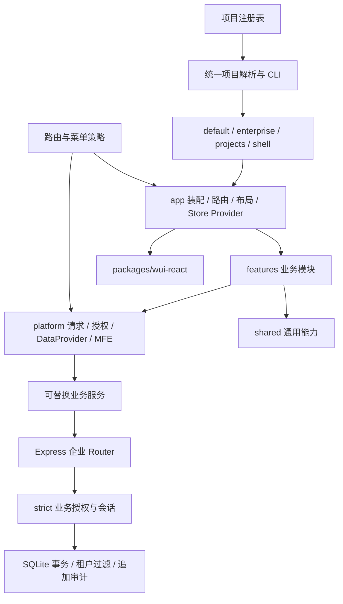

# 技术架构

## 产品与应用边界

Pro React Admin 是 React 管理应用工作区，包含组件展示应用、精简企业入口、多个独立项目、Module Federation Host/Remote 和独立 UI 包。它采用 React 19、Ant Design 6、React Router 7 Hash Router、Zustand 5、Webpack 5、TypeScript 6。声明版本见[自动生成参考](../reference/PROJECT_REFERENCE.md)，安装版本以 lockfile 为准。

`default` 保留展示功能；`enterprise` 仅注册工作台、用户、角色、访问审批、审计、登录验证器、认证和错误页。两者复用应用壳，但具有独立入口、路由、状态命名空间与产物。`api/enterprise` 提供可选的真实业务后端：租户账号、RBAC、TOTP、持久化用户/角色、会话撤销与事务审计。它适合单实例自托管；前端仍可通过 Provider 接入其它业务服务。

上图概括构建、代码依赖和服务层次。请求、身份切换、资源失效、Remote 加载及故障退化见[运行时链路与信任边界](./ARCHITECTURE_RUNTIME.md)；部署实例见[Vercel 与 SQLite](../deployment/VERCEL_SQLITE.md#选择部署方式)。

## 代码组织

| 目录                   | 职责                                                     | 约束                                      |
| ---------------------- | -------------------------------------------------------- | ----------------------------------------- |
| src/app/bootstrap      | React root、统一 Application、RemoteScope、Provider 装配 | 入口返回 root/store/unmount，支持明确销毁 |
| src/app/routing        | 展示应用路由模块、认证装配                               | 通用路由算法在 platform/navigation        |
| src/app/layouts        | 导航、搜索、面包屑、Tabs、布局预设                       | 使用项目路由和共享权限快照                |
| src/app/model          | 应用壳 Store 工厂与 Provider                             | 每个根实例独立，持久化按 projectId 命名   |
| src/features           | 按领域组织 pages/api/model/hooks                         | 页面通过领域 API 或 DataProvider 访问数据 |
| src/platform           | 请求、授权、导航、缓存、MFE、PWA、Tracking               | 不导入 app、features、pages、projects     |
| src/shared             | 通用组件和纯工具                                         | 不反向依赖平台或业务                      |
| src/projects           | 项目入口与路由差异                                       | 复用装配与平台，不复制基础算法            |
| packages/wui-react     | 可发布 UI 组件                                           | 自包含，禁止导入应用 src                  |
| api/enterprise         | HTTP adapter、业务服务、SQLite 存储、显式租户初始化      | 业务核心 strict；授权和审计在服务端执行   |
| src/pages / components | 展示页面和待迁移组件                                     | 新业务优先进入 features；按业务变化迁移   |

`config/path-aliases.json` 派生 TS/Jest/Webpack 别名。`@routers` 是构建时项目路由别名；`@app/routing` 明确指共享装配与展示路由，不等于当前项目。导入方向由 `check:import-boundaries` 强制检查。

## 路由、菜单与授权

`config/route-policy.json` 是权限、标题、翻译、菜单父级、排序和图标名的维护入口。页面结构仍由路由模块表达。导航树统一供侧栏和全局搜索使用，并同时过滤未注册页面和未授权页面；空分组不展示。面包屑从 React Router 实际匹配生成，参数页使用实际地址。`normalizeRouteTree` 统一 index/相对路径/绝对路径和 Tab metadata，projectB 不再复制算法。

`PermissionService` 维护身份绑定的缓存和订阅快照，`useSyncExternalStore` 让路由、菜单、按钮和角色守卫同时响应刷新、失败撤权、同页退出和跨标签页身份变更。订阅期间缓存到期会重新同步，回到窗口也检查失效缓存。旧请求由 generation 与当前凭据双重检查丢弃。策略优先于宽泛 routes grant，未知路径须显式授权。详见[授权](./USER_ROLE_PERMISSION.md)。

## 状态与生命周期

`createAppStore`/`AppStoreProvider` 为每个应用根创建 Zustand store，只持久化侧栏偏好，键为 `pro-react-admin:<projectId>:shell`；主题使用独立 `:theme` 键。业务数据、登录身份、ReactNode 和断点不持久化到壳 Store。同一个 projectId 的不同根仍隔离内存；后续根可以恢复同项目偏好。

`KeepAliveProvider` 管理本根的缓存、LRU 和定时器，默认保留最多 5 个非持久页面，首页独立保留。退出 Provider 取消定时器；Remote 的相同 pathname 不会互相驱逐。Tabs 刷新使用 generation 实际重挂载当前页面，保留其它页草稿。缓存限额以内保留草稿，超过限额会丢弃最旧页；这不是永久草稿存储。

`SessionScope` 在凭据或租户变化时销毁页面树、Tabs、KeepAlive 与业务 Provider，避免旧身份的数据与表单进入新工作区。企业权限缓存绑定 tenant/token，资源缓存实例绑定当前会话。当前 origin 仍只有一个活动身份，跨标签页共享并同步切换；不支持多个并行身份。Module Federation 不提供权限或样式沙箱；即使 Remote 脚本来自另一域名，仍在 Host 页面上下文执行。不可信子应用须使用独立 origin 的 iframe 等隔离边界。

## 数据与功能

`platform/modules` 只接受编译期模块契约 v2，旧 v1 和未知版本在装配前被拒绝。模块声明 routes、resources、Provider、dependencies、capability、宿主版本范围、数据迁移边界、卸载策略和 Header 插槽。default 选择组织管理与通知，enterprise 仅选择组织管理。注册表检查能力声明与编译功能一致、版本兼容、依赖环、重复路由和精确权限策略，Provider 随应用根创建与销毁；通知 Store 已消除全局单例。公共 Header 通过模块插槽装配通知，详见[模块指南](./MODULES.md)。

`platform/data/provider.ts` 定义分页、查询、取消、CRUD 和资源解析契约；REST adapter 复用已有请求层和会话处理，响应经领域 parser 验证。`features/administration` 提供用户 CRUD、角色配置、状态编辑、查询/分页和只读审计。demo Provider 在应用实例中维护数据并检查角色引用，REST Provider 对接真实接口；详见[企业资源接入](../operations/ENTERPRISE.md)。

`platform/data/cache.ts` 在 Provider 上装饰服务端数据缓存：按会话创建实例，资源/记录/规范查询组成键，15 秒 TTL、最多 100 项、同键请求共享、每消费者独立取消。成功写入通知相关资源重新加载，用户/角色写入失效审计，角色写入同时失效用户和角色选项；失败不缓存。失效或身份变化后，在途旧结果不能重新填充缓存。管理 Provider 另订阅经授权的资源失效 WebSocket；后台刷新、乐观更新和分布式缓存仍未接入，其它 feature 暂未统一迁移。

独立的 `useWebsocket` hook 提供通用客户端连接能力；企业资源事件通道使用 `platform/data/resourceEvents.ts` 与认证的 `/api/events` 服务端契约。开发代理同时转发票据 HTTP 请求与 WS upgrade。MFE `mfe:*` 桥仍是 Host/Remote 浏览器内事件与受限 `postMessage` 契约，不能替代服务端 WS 通道。企业 WS 当前为单实例进程内有界事件日志。

企业后端使用 Node 24 原生 TypeScript 与 SQLite，不新增数据库驱动。HTTP、业务授权、存储分别组织；所有列表/记录/写入按服务端会话的 tenant_id 过滤，header 不能选择另一个租户。每次请求从数据库读取有效账号和角色，不缓存授权结论。业务写入、会话撤销、审计在同一事务提交；数据库触发器拒绝审计 UPDATE/DELETE。数据库管理员仍可修改文件或触发器，因此它不是外部防篡改审计系统。边界与部署要求见[企业资源](../operations/ENTERPRISE.md)。

## 构建、部署与性能

`config/project-registry.mjs` 为 Webpack、项目命令、预览、清理、脚手架和部署组合提供同一项目解析；拒绝越界和重叠产物目录。脚手架同步 Remote import/type、部署 headers 和项目参考。生产缓存按项目/MFE 角色/环境隔离。

Sentry 在启用时动态加载；设置抽屉、鼠标效果、轨迹按需加载，装饰动画默认关闭。企业路由树不引用展示路由清单，避免把图表/媒体/编辑器编译为业务页面。实际收益由[构建统计](../development/BUILD.md)和浏览器测试确认。

部署使用现成产物组合，支持 Vercel、GitHub Pages 和 Nginx 静态镜像；HTML/Remote entry/manifest 及时刷新，内容 hash 资源长期缓存。CI 分别验证展示、企业、微前端、Storybook、组件库，上传可复用产物。修改流水线不代表已部署。

## 当前能力与边界

以下是仓库当前实现，不代表已部署环境完成验收。测试入口与报告见[质量门禁](../development/QUALITY.md)，上线前输入见[恢复 runbook](../runbooks/ENTERPRISE_RECOVERY.md)。

| 领域       | 当前实现                                                                                                                                                                      | 尚未覆盖的边界                                                                   |
| ---------- | ----------------------------------------------------------------------------------------------------------------------------------------------------------------------------- | -------------------------------------------------------------------------------- |
| 身份与数据 | schema v2 分离身份和组织成员，支持活动组织切换；SQLite 有离线迁移、校验备份、恢复及旧 schema 回滚演练                                                                         | 旧 v1 fixture 不代表真实部署库；没有账号关联/解绑运营流程、OIDC 或获批的 RPO/RTO |
| 资源更新   | 单实例 API 写入提交后发布经租户和读取权限过滤的 `users`、`roles`、`audit` 失效事件；客户端用一次性票据连接、重放或 `reset` 并清理缓存                                         | 事件日志只在进程内；没有跨实例 outbox/广播、记录内容订阅、后台刷新或乐观更新     |
| 模块扩展   | 静态 manifest v2 声明能力、宿主 SemVer 范围、迁移边界和卸载策略；旧 v1 直接拒绝                                                                                               | 清单只声明迁移要求，不执行迁移；没有运行期加载、来源信任或插件沙箱               |
| 类型与体验 | 新业务核心、平台/共享层、Tabs 和 Sider 有独立 strict 门禁；企业工作区补充键盘与对比度检查，en/zh 资源和 JSX 文案回归门禁已加入 `ci:quality`；Web Vitals 采集及 p75 汇总已实现 | 根 strict 仍为 false；演示页面本地化尚未完成，真实设备性能基线仍待部署流量       |

当前 i18n scanner v2 基线是 1,249 个未本地化候选，仓库现有 1,246 个；在 1,388 个识别的 JSX 文案/翻译调用中覆盖率为 10.23%。企业管理与身份登录页面的已识别文案为 100%。扫描是 AST 启发式，不能代表所有运行时文案；历史 v1 基线与 v2 不可直接比较。Web Vitals 的本地汇总也不能推定真实设备阈值。

## 后续推进

以下只列尚未完成的工作，按依赖顺序推进：

1. **生产数据门禁**：在真实旧库副本和目标卷复演升级、备份、恢复及兼容旧 artifact 的回滚；由部署 owner 确认 RPO/RTO、备份位置和写入冻结/重放方案。`db-admin drill` 仅测单机 SQLite 恢复与校验时间，不代替主机和网络恢复。
2. **身份运营决策**：由产品与部署 owner 确认 OIDC issuer、账号关联责任、组织角色来源和恢复方式后，实施 SSO、邀请/找回、成员管理及可能需要的其他认证方式。当前[OIDC ADR](../decisions/ADR-001-oidc-identity-and-tenant-roles.md)待签；企业本地账号已有自助 TOTP，但没有管理员线上重置验证器的绕过路径。验收需覆盖跨组织撤权、解绑和账号恢复。
3. **规模与更新**：先取得单实例负载、断线和恢复证据，再决定持久 outbox、跨实例顺序/广播、后台刷新、乐观更新及数据库迁移路径。当前单实例 WS 不能作为多实例一致性保证。
4. **插件信任与兼容**：若需要运行期第三方模块，另行设计来源验证、隔离、服务端扩展和版本协商；对宿主/模块/数据版本建立发布兼容矩阵，不能把静态 v2 清单当作动态插件机制。
5. **工程收紧**：按领域迁移遗留 JS 和展示页面，逐步扩展根 strict 与 i18n 覆盖；验证同一 artifact 的 API/Remote 环境切换和密钥边界。SSR/路由 loader、Tracking 插件页面生命周期仍需结合真实业务评估。
