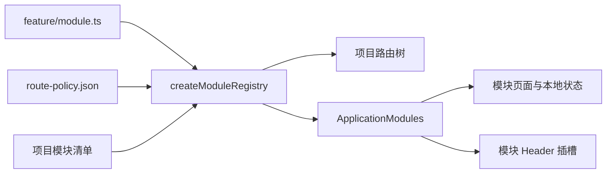

# 业务模块装配

## 已实现契约

`platform/modules` 只接受静态业务模块契约 v2。模块声明自己的路由、资源定义、Provider、依赖、能力、宿主版本范围、数据版本/迁移边界、卸载策略和可选 Header 插槽；应用选择模块清单，注册表校验后提供页面与 Provider 装配。当前组织管理与通知使用 v2。模块仍随宿主静态编译；没有运行期下载或执行第三方插件。

| 入口       | 清单文件                           | 启用模块                      |
| ---------- | ---------------------------------- | ----------------------------- |
| default    | src/app/modules/default.ts         | administration、notifications |
| enterprise | src/projects/enterprise/modules.ts | administration                |



企业入口没有引用通知模块清单，公共 Header 也不再直接导入 NotificationDrawer。是否提供通知按钮和通知页面由模块清单决定，不需要改 Header。启用通知模块的应用使用独立 NotificationsProvider，清空一个应用的消息不会修改另一个应用。

## 声明与接入

业务文件放在 `src/features/<name>`：`routes.tsx` 使用 React.lazy 引入页面，`module.ts` 声明模块。以下是组织管理的实际装配方式：

```ts
import type { ApplicationModule } from '@platform/modules'
import { AdministrationProvider } from './model/AdministrationProvider'
import { administrationResources } from './model/resources'
import { administrationRoutes } from './routes'

export const administrationModule: ApplicationModule = {
  id: 'administration',
  contractVersion: 2,
  version: '1.0.0',
  compatibility: { application: '>=5.1.0 <7.0.0' },
  capabilities: ['routes', 'resources', 'provider'],
  routes: administrationRoutes,
  resources: administrationResources,
  Provider: AdministrationProvider,
  data: { minimumSupportedVersion: 0, currentVersion: 0, migrations: [] },
  uninstall: { dataPolicy: 'retain', cleanup: 'provider-unmount' },
}
```

应用使用 `createModuleRegistry([administrationModule])` 创建一次注册表，把 `registry.routes` 放入主布局 children，用 `<ApplicationModules registry={registry}>` 包住主布局。应用的首页、登录、错误页和独立布局仍由应用路由管理。其它独立项目和 Remote 可以声明自己的模块清单；本次只迁移了 default 与 enterprise 的业务模块。

标题、语言键、菜单位置和页面权限仍只维护在 `config/route-policy.json`。增加模块页面时，在该策略中声明精确路径及权限；如需侧栏或搜索入口，再声明 menu。既有导航会按项目实际路由及当前权限过滤。`check:route-contract` 同时扫描应用 `.routes.tsx` 和各 feature 的 `routes.tsx`，检查重复页面、孤立菜单与失效策略。

新业务资源的领域 parser 和 Provider 留在 feature。注册表按模块 id 保存资源定义，例如 `registry.resources.administration.users`；它提供资源目录，不自动创建数据客户端或共享服务端缓存。页面继续从自己的类型化 Provider 获取数据，保留领域类型。

## 依赖、权限与插槽

模块 id 必须唯一，且 manifest 必须声明 `contractVersion: 2`；旧 v1 和未知版本均直接拒绝。清单至少声明一条路由，并给出模块 SemVer、应用版本范围、与实际编译功能完全一致的 capability 集、数据迁移边界和卸载策略。宿主版本从 package version 注入，范围支持 exact、`^`、`~`、比较符 conjunction 与 `||`；未知语法和不兼容版本失败关闭。当前内置模块范围是 `>=5.1.0 <7.0.0`，覆盖应用 6.x，同时保留对 5.1 及后续 5.x 宿主的兼容声明。

依赖通过 `dependencies: ['other-module']` 显式声明，应用须同时选择依赖。注册表按依赖顺序排列 Provider；依赖的 Provider 位于消费者外层。重复 id、缺失依赖、循环依赖和重复页面会在页面装配前失败。当前注册表只接受 v2，应用版本范围不匹配及其它契约版本均失败关闭。

`data` 以连续整数版本表示模块私有持久数据，迁移须有唯一 id、前后版本、SHA-256 checksum、备份要求和回滚级别；迁移链必须覆盖最小支持版本到当前版本。这个清单只声明兼容与运维要求，不在浏览器中执行迁移。需要持久化数据时，由模块所属服务实现迁移和备份流程。`uninstall.dataPolicy` 说明保留、归档后移除、经确认移除或纯内存数据；`cleanup` 必须与 Provider 的 React unmount 生命周期一致。当前清单不会自动删除后端数据。

业务模块页面必须有显式权限策略，不能覆盖为公共页面，也不能通过 handle.routePath 隐藏真实地址。大小写不同、参数名不同但匹配结构相同的路径视为冲突。该检查覆盖已选模块；与遗留应用路由的冲突继续由路由契约 CI 检查。

通知模块声明 `headerAction: { Component: NotificationAction, route: '/notifications' }`。Header 调用通用 ModuleActions；移动菜单按启用模块生成插槽。指定 route 的插槽只能关联本模块页面，并按该页面的现有策略实时授权。没有指定 route 的插槽仅由应用登录状态保护，涉及特定业务权限时必须指定路由或在组件内部使用 PermissionGuard。

## 状态与销毁

每个 ApplicationModules 挂载都会创建自己的业务 Provider 树。Provider 使用 useState 创建 Store 或客户端，useEffect 的返回函数注销监听、取消请求和清理计时器；不要在模块文件顶层创建用户数据单例。模块 registry 是静态声明，不存储用户数据。当前卸载策略只声明代码随宿主移除后 Provider 必须清理实例资源；它不提供动态模块热卸载、数据删除或自动回滚。

React StrictMode 会执行额外的 effect 安装与清理，模块 Provider 必须支持这一行为。模块选择发生在应用装配时；改变运行期模块清单、路由重建、版本协商、远程插件下载和不可信插件沙箱不属于当前契约。它也不替代 Module Federation 的 Remote 生命周期协议。

模块语言键继续使用现有 i18n 资源，尚未支持插件的运行期语言注册。身份仍共享当前 origin 的登录会话；根实例 Store 隔离不是租户隔离。

## 验证

```bash
pnpm run typecheck:boundaries
pnpm run check:import-boundaries
pnpm run check:route-contract
pnpm run test:jest --runInBand
pnpm run build:enterprise:stats
pnpm run test:e2e:enterprise
```

单测从公开装配接口验证依赖 Provider 顺序、两个根的状态与卸载、资源目录、权限失败关闭、插槽选择和配置冲突。浏览器验证默认入口的通知插槽及 lazy 详情页，以及企业入口没有启用通知。运行命令和报告入口见[质量门禁](../development/QUALITY.md)。
