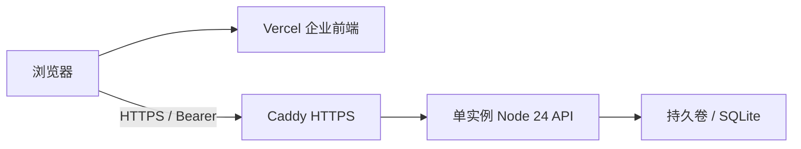

# Vercel 演示登录与 SQLite 部署

本指南给出纯前端演示登录，以及 Vercel 前端连接持久化 SQLite API 的部署步骤。若选择独立的 Vercel Enterprise API 项目和 Neon PostgreSQL，请使用 [Vercel + Neon 部署指南](./VERCEL_NEON_ENTERPRISE.md)。所有命令从仓库根目录执行；API 主机上的步骤需在该主机的仓库目录执行。

## 选择部署方式

| 目标                                 | Vercel 部署内容                 | 数据和登录来源                          |
| ------------------------------------ | ------------------------------- | --------------------------------------- |
| 快速在线展示用户、角色、审计界面     | 企业静态前端，mock 开启         | 浏览器演示账号；业务数据刷新后重置      |
| 真实租户登录、持久化和服务端权限     | 企业静态前端，mock 关闭         | 外部单实例 Node API + 持久卷上的 SQLite |
| 前端和 API 都运行在 Vercel           | 独立前端和 Enterprise API 项目 | Neon PostgreSQL；见新部署指南           |

**不能将 SQLite 文件数据库直接部署到 Vercel Functions 并保存业务写入。** Vercel 官方说明：函数文件系统是临时的，多实例也没有共享的持久文件。上传 `.sqlite` 或放到 `/tmp` 都不能满足账号、会话和审计的持久化要求。文件型 `EnterpriseStore` 继续用于本地和持久 API 主机；Vercel API 使用独立的 PostgreSQL Store。[Vercel 对 SQLite 的说明](https://vercel.com/kb/guide/is-sqlite-supported-in-vercel)

### 如果希望前端、API 都部署在 Vercel

使用已实现的 [独立 Enterprise API + Neon PostgreSQL](./VERCEL_NEON_ENTERPRISE.md) 路径。新建 API 项目、关联 Neon、运行显式迁移与初始化，再重新构建前端指向 API 域名。当前指南以下内容只针对 SQLite API 主机。

真实登录采用下面的部署结构：



本地 `.env.development.local` 不会自动成为线上配置。下面通过构建命令明确设置浏览器变量，服务端配置仅保留在 API 主机。

## 路径一：纯 Vercel 演示登录

不需要后端或数据库。先安装 CLI 并登录，然后关联用于企业演示的 Vercel 项目；`link` 会交互选择账号和项目，关联信息保存在 `.vercel/project.json`：

```bash
npm install --global vercel@latest
vercel login
vercel link
```

本地构建并生成 Vercel 静态产物：

```bash
pnpm exec cross-env REACT_APP_USE_MOCK=true APP_BASE_URL= PUBLIC_URL=/ pnpm run build:enterprise:stats
pnpm run vercel:prepare:enterprise
```

检查构建完成后，再发布这一份产物：

```bash
vercel deploy --prebuilt --prod
```

访问 CLI 返回的生产域名，例如 `https://your-enterprise-project.vercel.app/#/signin`。点击 `admin@test.com` 自动填入浏览器生成的密码，点击登录并完成滑块验证；可使用其它演示账号比较权限。

`vercel:prepare:enterprise` 将 `dist-enterprise` 复制到 `.vercel/output/static`，生成 Build Output API v3 配置，只包含静态前端文件。它会替换之前的 `.vercel/output`，保留项目关联和其它本地配置；不会部署根 `api/`，也不会上传 SQLite 或服务端凭据。应用使用 Hash 路由，静态产物无需业务路由的 HTML fallback。

该模式用于界面演示：角色编辑不改变演示账号的登录权限，新建用户也不能成为演示登录账号。需要真实行为时选择路径二。

## 路径二：Vercel 前端 + 持久化 SQLite API

### 准备 API 主机与配置

准备一台安装 Docker 和 Docker Compose 的持久主机。将 `api.example.com` 的 DNS 指向该主机，开放 TCP 80/443；下面的 Caddy 网关自动申请和续期 HTTPS 证书。

在 API 主机取得仓库，复制服务器配置模板：

```bash
git clone https://github.com/wkylin/pro-react-admin.git
cd pro-react-admin
cp .env.enterprise.production.local.example .env.enterprise.production.local
```

用编辑器修改 `.env.enterprise.production.local`。将域名、Vercel 生产 origin 和密码替换为你的实际值：

```dotenv
API_DOMAIN=api.example.com
CORS_ORIGINS=https://your-enterprise-project.vercel.app
NODE_ENV=production
ENTERPRISE_ENABLED=true
ENTERPRISE_DB_PATH=/data/enterprise.sqlite
ENTERPRISE_TOTP_KEY=
TRACKING_STORE=memory
TRACKING_API_PORT=5200
ENTERPRISE_BOOTSTRAP_TENANT=acme
ENTERPRISE_BOOTSTRAP_TENANT_NAME=Acme
ENTERPRISE_BOOTSTRAP_NAME=Administrator
ENTERPRISE_BOOTSTRAP_EMAIL=admin@example.com
ENTERPRISE_BOOTSTRAP_PASSWORD="替换为你自己的12至256字符密码"
```

`CORS_ORIGINS` 必须包含真实访问前端的精确 origin，不含路径或末尾 `/`；多个可信域名用逗号分隔。Vercel 的 Preview 域名与 Production 域名不同，需要预览环境登录时显式加入对应域名。SQLite 配置始终是 API 容器内的文件路径，不能填写 HTTPS/libSQL 地址。

如需启用企业账号的登录验证器，运行 `openssl rand -hex 32`，将输出的 64 位十六进制值填入 API 主机的 `ENTERPRISE_TOTP_KEY`。部署后必须保留同一密钥，并与数据库备份分别安全保存；前端 Vercel 环境变量中不要放此密钥。留空时密码登录仍可用，但不能绑定验证器。已有绑定时丢失或更换密钥会导致企业 API 拒绝启动。操作流程见[企业账号登录验证器](../operations/ENTERPRISE.md#企业账号登录验证器-totp)。

### 构建、初始化、启动

以下均在 API 主机运行：

```bash
# 检查配置并构建 Node 24 API 镜像
docker compose --env-file .env.enterprise.production.local -f compose.enterprise.yaml config --quiet
docker compose --env-file .env.enterprise.production.local -f compose.enterprise.yaml build api

# 建立或升级 schema；正式迁移前先按运维流程验证离机备份
docker compose --env-file .env.enterprise.production.local -f compose.enterprise.yaml run --rm api node server/enterprise/db-admin.mjs migrate

# 首次初始化该租户，数据写入同一持久卷
docker compose --env-file .env.enterprise.production.local -f compose.enterprise.yaml run --rm api node server/enterprise/bootstrap.mjs

# 将初始化的租户管理员设为平台管理员，才能使用租户管理菜单
docker compose --env-file .env.enterprise.production.local -f compose.enterprise.yaml run --rm api node server/enterprise/platform-admin.mjs grant --tenant acme --email admin@example.com
```

看到 `Tenant provisioned` 后，用编辑器删除配置文件中的五项 `ENTERPRISE_BOOTSTRAP_*`，保留其它配置，并记住初始化密码。已有租户返回冲突，后续升级和重启不再初始化。

```bash
# 启动真实 API 与 HTTPS 网关
docker compose --env-file .env.enterprise.production.local -f compose.enterprise.yaml up -d
docker compose --env-file .env.enterprise.production.local -f compose.enterprise.yaml logs --tail=100 api gateway

# 未登录应返回 HTTP 401 的 JSON，表明请求已经到达认证 API
curl -i https://api.example.com/api/auth/session
```

`enterprise-data` 持久卷保存 `/data/enterprise.sqlite` 及 WAL 文件；容器重建、普通 `down`/`up` 保留业务数据。不要使用 `docker compose down -v` 删除卷。API 不发布主机端口，网关在容器网络访问 `api:5200`；仅 HTTPS 网关对外提供服务。一个数据库对应一个 API 实例，不能以共享文件方式横向扩容。

`TRACKING_STORE=memory` 只控制埋点数据，用户、角色、会话和审计仍保存到 SQLite。服务启动只校验 schema，不自动升级。迁移、带校验 manifest 的备份和恢复命令见[企业 SQLite 运维](../operations/ENTERPRISE.md#sqlite-迁移备份与恢复)；正式环境仍需部署方确定异机备份频率、保留周期和 RPO/RTO，并在真实旧库副本上演练。

### 构建并部署真实登录前端

在开发机仓库中关联企业 Vercel 项目。已有正确项目关联时跳过 `login` / `link`：

```bash
vercel login
vercel link

# 使用公网 HTTPS API；构建脚本显式关闭 mock
pnpm exec cross-env APP_BASE_URL=https://api.example.com PUBLIC_URL=/ pnpm run build:enterprise:api
pnpm run vercel:prepare:enterprise
vercel deploy --prebuilt --prod
```

构建命令把 API 地址编译进浏览器包，部署时改 Vercel 环境变量不会修改已有产物。修改地址后重新构建、准备并部署；不用将 `ENTERPRISE_DB_PATH`、bootstrap 密码或管理 token 添加到 Vercel 前端配置。

访问生产域名 `/#/signin`，填写租户 `acme`、邮箱 `admin@example.com`、初始化密码。真实登录没有测试账号列表和演示滑块。

1. 管理员在角色页添加 `viewer`，权限设为 `home:read`、`user:read`。
2. 在用户页创建 `viewer@example.com`，设置自选 12..256 字符密码、角色 `viewer`、状态启用。
3. 退出后用租户 `acme` 和该用户登录，验证只读菜单与按钮限制。
4. 刷新或重建 API 容器后再次登录，确认账号、角色和审计仍在持久卷中。

如果需要公开账号演示，可以分享这个只读用户；管理员使用自己的初始化凭据。详细权限配置见[快速上手](../development/GETTING_STARTED.md#权限设置)。

### 更新与排查

修改 `CORS_ORIGINS` 或其它 API 环境变量后，在 API 主机运行 `up -d api` 重建服务配置：

```bash
docker compose --env-file .env.enterprise.production.local -f compose.enterprise.yaml up -d api
```

更新后端源码时重新构建 API：

```bash
docker compose --env-file .env.enterprise.production.local -f compose.enterprise.yaml up -d --build api
```

| 现象                      | 检查                                                                          |
| ------------------------- | ----------------------------------------------------------------------------- |
| Vercel 页面仍显示测试账号 | 是否重新执行真实构建；是否部署了新生成的 `.vercel/output`                     |
| 登录请求返回 HTML 或 404  | `APP_BASE_URL` 是否为公网 API 地址；Vercel 静态前端本身不提供 `/api/auth`     |
| 浏览器提示 CORS           | `CORS_ORIGINS` 是否与当前 Vercel origin 完全一致；修改后是否重建 API 容器     |
| HTTPS 或网关失败          | DNS、80/443、网关日志以及 API 启动日志；API 主机不能只提供 HTTP 给 HTTPS 前端 |
| 初始化失败                | 自选密码是否 12..256 字符、租户是否已存在、持久卷是否可写                     |
| 重启后账号消失            | 是否使用同一 Compose 项目及 `enterprise-data` 卷；是否误删卷或换了数据库路径  |

官方依据：[Vercel 对 SQLite 的说明](https://vercel.com/kb/guide/is-sqlite-supported-in-vercel)、[Build Output API](https://vercel.com/docs/build-output-api)、[CLI prebuilt 部署](https://vercel.com/docs/cli/deploy#prebuilt)。
